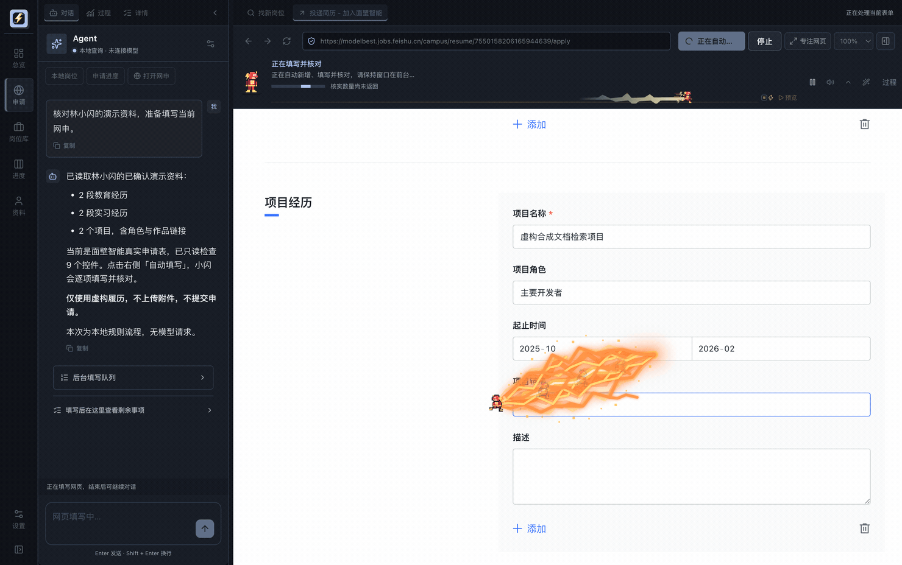
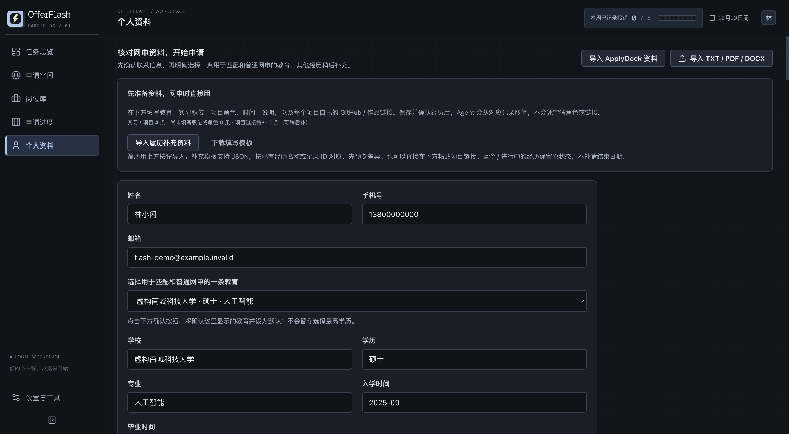

<h1>OfferFlash ⚡</h1>

<strong>简历只想写一次，网申不想再填十遍。</strong>

一个用于求职申请的桌面 Agent：整理简历、推荐岗位、辅助填写招聘网页，并跟踪投递进度。

  <a href="https://github.com/2x2xz/OfferFlash/releases/tag/v0.15.0"><strong>macOS Demo ↗</strong></a>
  &nbsp;·&nbsp;
  <a href="docs/model-workspace-demo.md">完整演示</a>
  &nbsp;·&nbsp;
  <a href="docs/architecture.md">技术设计</a>

macOS (Apple Silicon) · Electron · React · TypeScript · Pi SDK

---

## ⚡ 先看它干活

  

左边是 Agent，右边是企业网申。真实页面、虚构资料；视频为 4× 速预览，没有提交申请。<a href="docs/model-workspace-demo.md">看原速演示与操作说明 ↗</a>

## 为什么做 OfferFlash？

求职时，同一份简历往往要填进多个招聘系统。学校、实习、项目明明都写过了，换家公司又得重新录入；日期、下拉框和「新增一段经历」的操作也各不相同。

OfferFlash 把这些操作放在一个工作台里：**资料确认后交给 Agent 复用，缺信息或拿不准时，再请用户补充。** 从找岗位、填写申请到跟踪进度，可以接着处理。

## 能帮你省掉哪些操作

<table>
  <tr>
    <td width="50%">
      <strong>📄 简历不用反复抄</strong>  
      导入 PDF、DOCX 或 TXT 简历，整理教育、实习、项目和论文。重要信息先确认，再用于后面的网申。
    </td>
    <td width="50%">
      <strong>⚡ 在真实网页上辅助填写</strong>  
      左侧和 Agent 交流，右侧打开招聘页面。识别字段、填写已有资料，再读回检查；缺资料或写入失败会提示。
    </td>
  </tr>
  <tr>
    <td>
      <strong>📌 投到哪一步，一眼能找到</strong>  
      搜索已接入来源的国内岗位，加入待申请列表，继续记录笔试、面试和 Offer，不用在几个表格间来回翻。
    </td>
    <td>
      <strong>🧩 多个申请分开处理</strong>  
      后台任务使用独立会话和页面，已对 1 / 3 / 5 并发做过测试。覆盖范围仍取决于接入的来源和招聘页面。
    </td>
  </tr>
</table>

### 工作台长这样

<table>
  <tr>
    <td width="33%" align="center">
       
      投递总览
    </td>
    <td width="33%" align="center">
       
      Agent + 网申工作区
    </td>
    <td width="33%" align="center">
       
      个人资料
    </td>
  </tr>
</table>

截图来自实际应用界面。总览和资料页使用独立展示数据，申请空间静态图来自规则填写录制；人物资料均为虚构。

## 🛠️ 技术上怎么做的？

**确认资料 → Agent 观察页面 → 生成填写计划 → 受控执行 → 读回核对**

填表时，模型需要理解该填什么，执行器还要**确保它填在对的地方，并且真的填进去了**。

OfferFlash 用 Pi SDK 管理模型会话，Electron 主进程负责应用状态和授权；Agent 负责理解当前表单与资料之间的对应关系，真正的网页输入由 `BrowserController` 执行。写入前会检查页面、原值和目标控件，写完再读取结果。

简历资料、岗位和申请记录保存在本机 SQLite。跟着字段跑的小闪电是界面动效，不参与实际输入。

更完整的进程划分、工具调用和安全边界放在 [架构文档](docs/architecture.md) 里。

## 📊 实际跑出来的结果

<table>
  <tr>
    <td width="50%" align="center">
      <h3>34 项</h3>
      <strong>指定字段读回一致</strong> 
      单站单次完整履历演示：两段教育、两段实习、两个项目
    </td>
    <td width="50%" align="center">
      <h3>56 / 60</h3>
      <strong>普通草稿任务严格完成</strong> 
      20 家官网 × 3 组并发测试，完成率 93.3%
    </td>
  </tr>
</table>

这两组是**不同范围的测试**，不能理解成任意招聘网站的整表成功率；附件和最终提交也没有包含在验证中。详细方法、失败情况、耗时和模型成本见 [测试记录](docs/demo-metrics.md)。

岗位推荐这次固定用了 **150 条国内真实岗位、6 份虚构履历和 3 种求职偏好**。关键词召回＋模型重排的职责相关比例是 **58/80（72.5%）**，前 20 条召回 **158/222（71.2%）**，这批比纯语义和混合检索更好，所以先用这个方案。

这些是使用模型标注标签的开发回归结果，72.5% 衡量职责相关性，不是“确认能投”的比例；资格与截止日期应按岗位要求核对。[评测方法与口径](docs/release/qualification-retrieval-v2.md)

## 🚀 跑起来

**运行环境：macOS · Apple Silicon。**

**从源码运行**：需要 Node.js 22.19 或更新版本。

~~~bash
npm ci
npm start
~~~

在线功能需要自行配置模型 API Key；后台模型队列目前支持百炼北京的 `qwen-flash`。

完整履历填写使用已审阅的飞书招聘页面；登录、验证码、附件上传、声明确认和最终提交由用户完成。macOS 构建未签名、公证。

---

  <a href="docs/architecture.md">Architecture</a> ·
  <a href="docs/demo-metrics.md">Evaluation</a> ·
  <a href="docs/privacy.md">Privacy</a> ·
  <a href="THIRD_PARTY_NOTICES.md">Third-party notices</a>

OfferFlash ⚡ · 代码使用授权及第三方组件许可见 Third-party notices。

