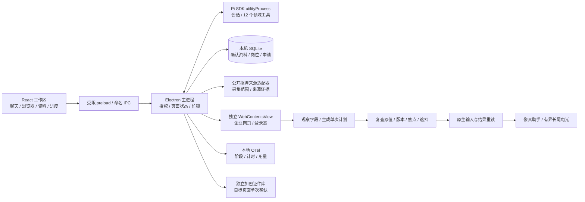

# OfferFlash 架构

Pi 是唯一的模型会话内核。业务事实由主进程和 SQLite 保存，模型不能直接修改网页或读取证件库。应用自有任务规则和三个固定注册的 Skill 按需使用，不扫描用户的全局插件或外部系统提示词。

`apps/desktop/backend.ts` 接收受限 IPC，持有资料、浏览器和后台队列。`packages/browser/src/controller.ts` 观察页面并保存计划；`packages/forms` 负责可复用事实与字段的对应。执行前会再次核对页面、资料、原值与可见位置，写后重读。计划只能尝试一次；不确定是否已经写入时不会自动重复输入。

长尾电光由独立 closed shadow 装饰层绘制，只接受实际观察到的坐标。它没有可交互控件，不调用网页输入，不作为成功证据。后台队列走独立受限 DOM 路径，和前台原生输入互斥。

证件号码与普通资料分开：`SensitiveIdentityVault` 负责系统加密，`SensitiveIdentityHost` 只向界面提供掩码和目的地，确认 nonce 与执行计划 ID 分离。普通自动填写仍跳过证件。目标 URL、字段原值、资料或证件版本变化都要求重新核对。

## 执行中的用户问答

固定 request_user_input 工具通过宿主 question broker 等待用户回答；界面在输入区显示问题，确认后返回同一任务。等待期间暂停扣除原执行预算，任务停止、上下文改变和重复响应均受检查。临时回答不自动写入长期资料。
