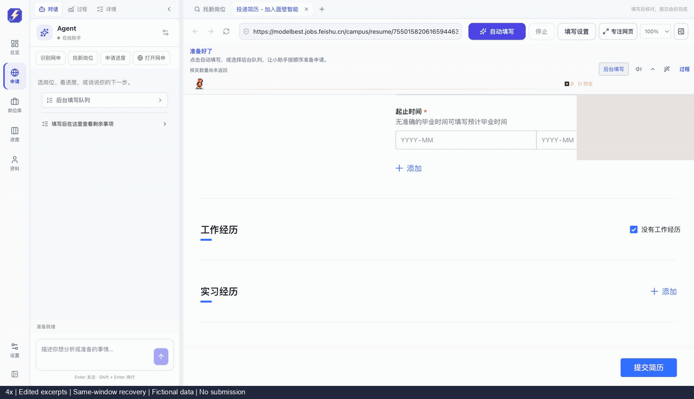
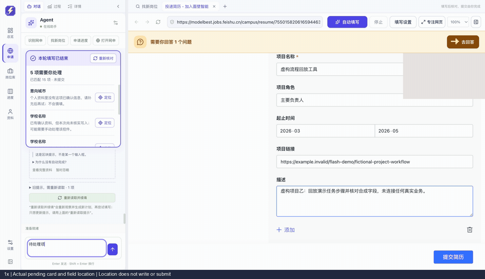

# 两段官网演示：连续填写与待处理定位

两段均来自面壁智能招聘官网的同一独立窗口，保留实际左侧对话区与右侧网页。履历中的姓名、邮箱、教育、实习、项目为虚构录制资料；学校和岗位名称为公开真实名称，不表示该候选人具备岗位资格。登录账号、手机号已遮挡。正常 App、个人资料库与微众网页草稿没有参与录制。

## 连续填写（4× 操作节选）

[查看原速操作节选](screenshots/offerflash-workspace-full.gif)。节选去除了人工准备和停顿，保留真实操作顺序，并在画面下方注明倍速、节选与同窗口续填。不是一次无中断全表通过的录像，也不作为效率对照。

首次执行在第一个项目说明处保守停止：小数中心坐标被取整后落到可见区域边缘。随后在原窗口通过“定位”移到对应字段，再点击真实自动填写入口续填，没有刷新或关闭网页，没有重填已正确的内容。最后以专用执行器的字段回读和逐值比较核对：两段教育、两段实习、两个项目的 32 个字段，加上姓名和邮箱，共 34 个目标一致。12 个起止年月包含在核对范围内。

录制进程保留了原静态后端；发布包另修正了该边缘判断，新增用例先复现同一错误，再在修正后通过，63 项相关检查通过。不能把录制中的人工定位恢复称为新补丁的官网首轮通过。

这段使用面壁既有专用填写流程，普通资料按已确认来源受控执行；本轮在线模型请求为 0。之前旧演示的 12 次 qwen-flash 请求与 11,272 token 属于[历史录制](https://github.com/2x2xz/OfferFlash/blob/v0.23.0-preview.1/docs/model-workspace-demo.md)，不沿用为本轮统计。

## 新卡片与定位（原速操作节选）

续填后，在实际对话输入“待处理项”，由当前页面只读回读生成卡片；随后点击“定位意向城市”，网页真实滚动并框出目标。定位前后全体原生字段的值与勾选状态一致，未写值、未勾选、未提交。

通用回读器在这个站点仍保守报告两所已选学校及“没有工作经历”勾选项未核实，因此卡片里的 20 项匹配与 4 项待处理，不是上述专用执行器 34 个目标的同一统计口径，也不意味着这三项真的缺少个人资料。保留原始卡片提示，不隐藏这项限制；不能唯一识别的目标会提示重新核对，而不会猜位置。

录制采用实际工作台和原生官网视图同轮取图，按真实子视图位置合成；不是操作系统整屏录像，不保证两个图层原子同步。动态拖尾采样证实真实可见，未暂停或跳转动效来制造画面。素材经过采集时遮挡、每帧本地检查与成片复核；Key、Cookie、原始轨迹和个人资料不发布。录制窗口保留，无自动关闭。

附件没有上传，官网草稿与申请写入接口受录制保护；未提交申请。34 个目标的本机回读一致不表示附件、声明或企业服务器可提交性已经通过。
